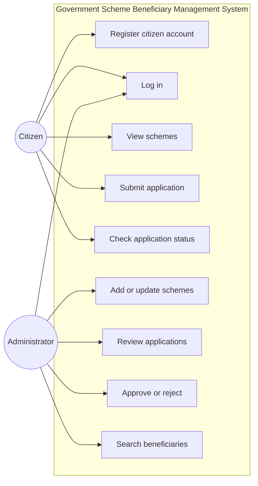
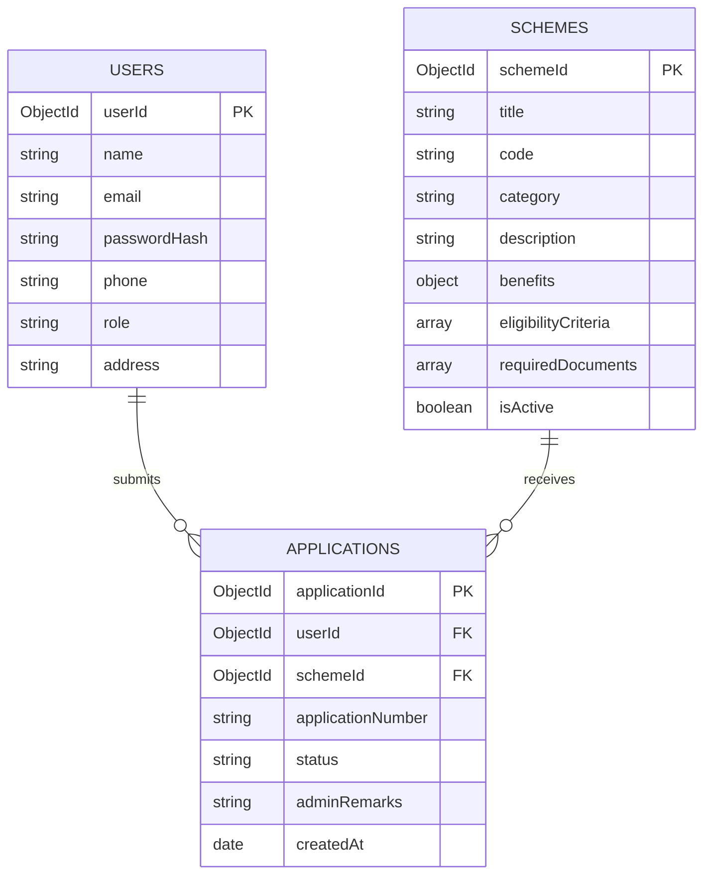
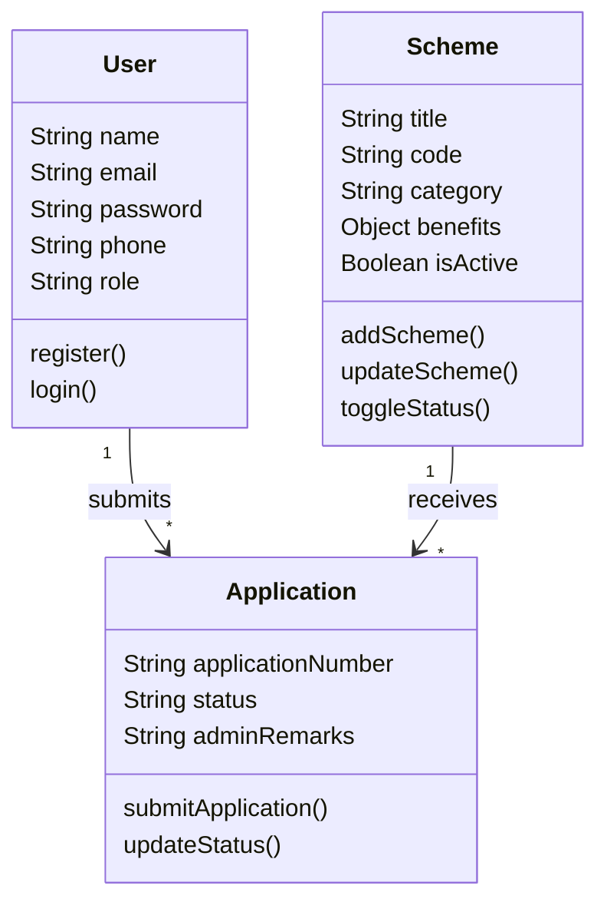
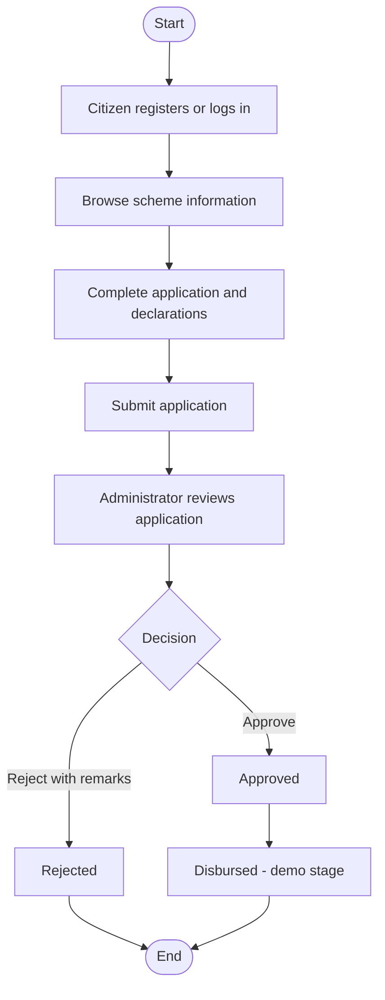
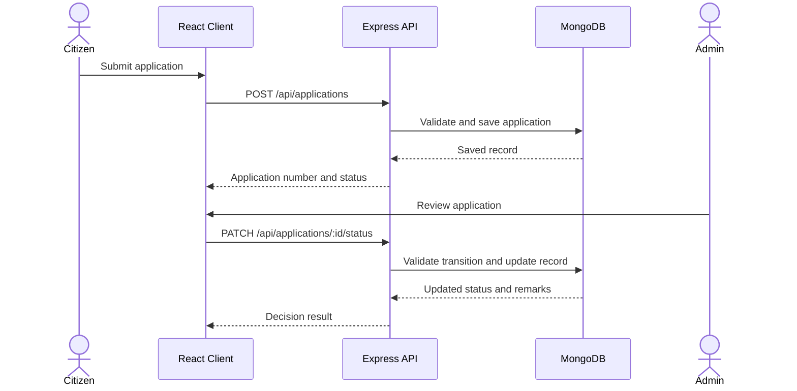

# GOVERNMENT SCHEME BENEFICIARY MANAGEMENT SYSTEM

### BACHELOR OF TECHNOLOGY IN COMPUTER SCIENCE AND ENGINEERING
**Subject:** Full Stack Development - 2 (FSD-2)
**Academic Year:** 2026-2027

### Project Team

| Student | Roll Number |
|---|---|
| G. Ramanuja Sai | 25505A0508 |
| G. Hemanth Kumar | 25505A0509 |
| K. Charan | 25505A0510 |
| K. Sandeep | 24501A05A8 |

**PRASAD V POTLURI SIDDHARTHA INSTITUTE OF TECHNOLOGY**
Kanuru, Vijayawada - 520007

---

## CERTIFICATE

This is to certify that the project titled **Government Scheme Beneficiary Management System** was developed by the students listed above as part of Full Stack Development - 2 during the academic year 2026-2027.

| Project Guide | Head of Department |
|---|---|
| Signature: ____________________ | Signature: ____________________ |

---

## INDEX

1. Abstract
2. Introduction
3. Objectives and Scope
4. Software Used
5. UML Diagrams
6. Database Design
7. Folder Structure
8. Result and Output Screens
9. Conclusion and Future Scope
10. References

---

## 1. ABSTRACT

The Government Scheme Beneficiary Management System is a web application for publishing government scheme information and managing citizen applications. Citizens can create accounts, review scheme requirements, submit applications, and check their application status. Administrators can manage schemes, review applications, record decisions, and search beneficiary records.

The system stores records in MongoDB and separates citizen and administrator access. It is an academic demonstration: scheme information and benefit values are fictional, benefit disbursement is simulated, and the application form records a required-document checklist without uploading files.

---

## 2. INTRODUCTION

### Problem Statement

Citizens can have difficulty finding scheme information and checking the progress of applications. Paper-based record keeping can also lead to duplicate entries, mistakes, and processing delays. This project provides one web portal for scheme information, application submission, review, and status tracking.

### Project Overview

The system has two user roles:

1. **Citizen:** Register and log in, view schemes and their requirements, submit an application, and check its status.
2. **Administrator:** Add or update schemes, close or reopen schemes, review submitted details, record an approval or rejection, and search approved beneficiary records.

Passwords are hashed with bcrypt. JWT authentication protects private routes, and beneficiaries can access only their own applications. The backend validates application data and enforces permitted status changes.

---

## 3. OBJECTIVES AND SCOPE

### Objectives

- Provide scheme names, categories, descriptions, benefits, eligibility criteria, and required documents.
- Let citizens register, log in, and submit scheme applications online.
- Let administrators manage schemes and review submitted applications.
- Let citizens check application status and administrator remarks.
- Maintain searchable records of approved beneficiaries.
- Reduce manual record keeping and provide role-based access.

### Scope

The project includes registration and login, a searchable scheme catalogue, scheme details, an application form, beneficiary status records, an administrator review queue, scheme management, and beneficiary search. Application statuses are Submitted, Under Review, Approved, Rejected, and Disbursed. Disbursed is a demonstration-only stage after approval.

The application form stores the required-document list as demonstration metadata. Real file upload, real benefit payments, Aadhaar numbers, and banking credentials are outside the scope.

---

## 4. SOFTWARE USED

| Area | Technology |
|---|---|
| Frontend | React 19, Vite, Tailwind CSS, React Router |
| Backend | Node.js, Express.js |
| Database | MongoDB, Mongoose |
| Authentication | bcryptjs, JSON Web Tokens |
| Development tools | Visual Studio Code, web browser, Postman, Git |

The React client calls the Express REST API. Express validates requests, applies role checks, and stores users, schemes, and applications through Mongoose models.

---

## 5. UML DIAGRAMS

### Use Case Diagram



### ER Diagram



### Class Diagram



### Activity Diagram



### Sequence Diagram



---

## 6. DATABASE DESIGN

| Collection | Main fields | Purpose |
|---|---|---|
| Users | Name, email, hashed password, phone, role, address and location | Stores citizen and administrator accounts. |
| Schemes | Title, code, category, descriptions, benefits, eligibility, documents, deadline and active status | Stores information displayed in the public catalogue. |
| Applications | User and scheme references, application number, applicant details, declarations, document checklist, status, remarks and status history | Stores applications and their review progress. |

The beneficiary directory is built from approved or disbursed application records; it is not a separate collection. The database does not store Aadhaar numbers or bank credentials.

---

## 7. FOLDER STRUCTURE

```text
project/
├── backend/
│   └── src/
│       ├── config/db.js
│       ├── controllers/
│       ├── middleware/
│       ├── models/User.js, Scheme.js, Application.js
│       ├── routes/
│       ├── seeds/seed.js
│       ├── tests/testWorkflow.js
│       ├── utils/statusWorkflow.js
│       └── server.js
└── frontend/
    └── src/
        ├── api/
        ├── components/Navbar.jsx, ProtectedRoute.jsx, StatusBadge.jsx
        ├── context/AuthContext.jsx
        ├── pages/
        ├── App.jsx
        ├── index.css
        └── main.jsx
```

---

## 8. RESULT AND OUTPUT SCREENS

The application provides these screens:

1. **Home:** Short project introduction and links to schemes or the relevant dashboard.
2. **Scheme catalogue:** Searchable list of scheme names, categories, codes, and benefits.
3. **Scheme details:** Description, benefit, eligibility criteria, required documents, and application link.
4. **Registration and login:** Citizen account creation and authentication.
5. **Application form:** Applicant details, eligibility declarations, purpose, required-document checklist, and truthfulness declaration.
6. **Beneficiary dashboard:** Application number, submission date, current status, and administrator remarks.
7. **Admin dashboard:** Application review, add/update/close/reopen schemes, and beneficiary search.

---

## 9. CONCLUSION AND FUTURE SCOPE

### Conclusion

The system brings scheme information, application records, administrative review, and status tracking into one web application. It demonstrates the main citizen and administrator workflows described in the project overview.

### Future Scope

- Add secure document upload and verification.
- Add email or SMS status notifications.
- Add regional language support.
- Connect approved applications to a real benefit-disbursement service only when authorized infrastructure is available.

---

## 10. REFERENCES

1. React Documentation - https://react.dev
2. Vite Documentation - https://vite.dev
3. Express Documentation - https://expressjs.com
4. MongoDB Documentation - https://www.mongodb.com/docs
5. Mongoose Documentation - https://mongoosejs.com/docs
6. Tailwind CSS Documentation - https://tailwindcss.com/docs
